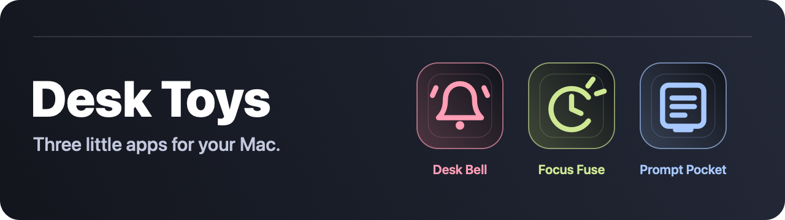

<p align="center">
  
</p>

# Desk Toys for macOS

Three independent menu bar apps from [muddgrrrl](https://github.com/muddgrrrl). Each one works offline and needs no Accessibility permission.

| App | What it does | Download |
| --- | --- | --- |
| **Desk Bell** | Add a sound and a brief desktop flash to your own small wins. Choose Glass, Pop, or Funk, and toggle sound and flash separately. | [DeskBell-macOS.zip](https://github.com/muddgrrrl/Desk-Toys/releases/latest/download/DeskBell-macOS.zip) |
| **Focus Fuse** | Start, pause, and resume a focus timer from the menu bar. The countdown remembers its deadline across sleep and relaunch, with an optional finish sound. | [FocusFuse-macOS.zip](https://github.com/muddgrrrl/Desk-Toys/releases/latest/download/FocusFuse-macOS.zip) |
| **Prompt Pocket** | Save, search, edit, and pin reusable prompts. Copy a prompt to the clipboard when you want to use it. | [PromptPocket-macOS.zip](https://github.com/muddgrrrl/Desk-Toys/releases/latest/download/PromptPocket-macOS.zip) |

## Install

The apps support **macOS 13 or later** on Apple silicon and Intel. Download the ZIP for the app you want, extract it, move the app into Applications, and open it. Look for its icon in the menu bar. The release apps are ad-hoc signed. If macOS declines to open the download, build a local copy using the steps below.

## Use the apps

- **Desk Bell** uses **Control–Option–B** to ring. Open the bell icon’s **Settings…** to choose a tone or make the flash silent. The flash appears on the display under your pointer and leaves the foreground app focused.
- **Focus Fuse** shows its remaining time in the menu bar. Choose a 5, 15, 25, or 45 minute session in **Open Timer…**. You can start, pause, resume, or reset from the menu. Keep the app running for an audible finish.
- **Prompt Pocket** opens with **Control–Option–J**. Choose **New Prompt** to add one, or use the row menu to edit, pin, or delete it. The **Copy** button writes only that prompt to your clipboard. The shelf lives in `~/Library/Application Support/Prompt Pocket/prompts.json`.

If another app has claimed a shortcut, use the menu bar controls.

## Build from source

Install Apple’s command-line tools with Swift 5.9 or newer. From the repository root, run:

```sh
bash build.sh
```

The script generates the app icons, compiles the universal binaries, ad-hoc signs each app, runs its self-test, and outputs ZIP archives and SHA-256 checksums in `dist/`. Each archive contains a standalone app. The executables also accept `--smoke-test` in a graphical session to check that the menu bar item and window open.

The apps use Swift, AppKit, and SwiftUI. The global shortcuts use the macOS hotkey API. [OpenWhip for macOS](https://github.com/muddgrrrl/OpenWhip-Mac) is a separate project.

## License

[MIT](LICENSE)
